# Android screenshots

Branch `main`, commit a2039e4, run 46.

## phone-detail-dark

## phone-detail-expanded

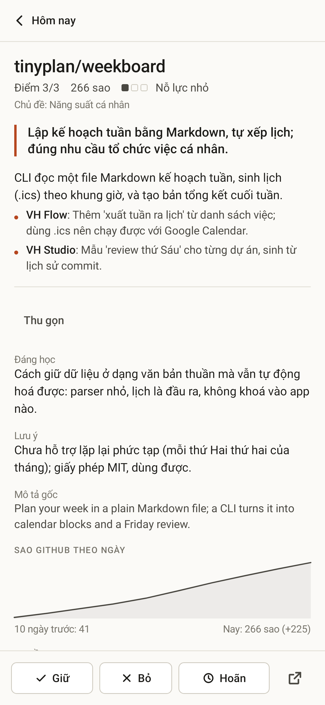

## phone-detail-light

## phone-explore-topic

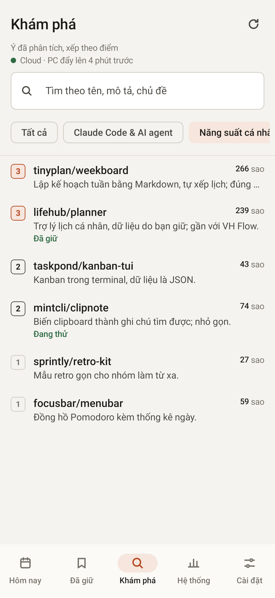

## phone-kept-cloud

## phone-offline-cache

## phone-settings-dark

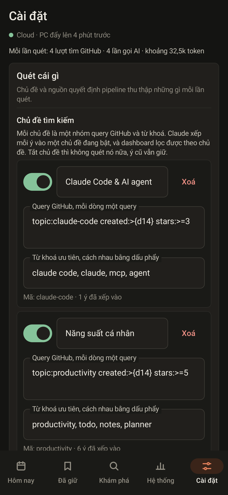

## phone-settings-delete-topic

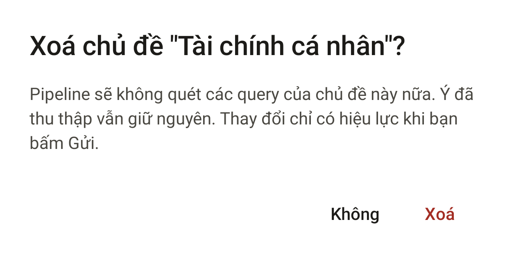

## phone-settings-invalid

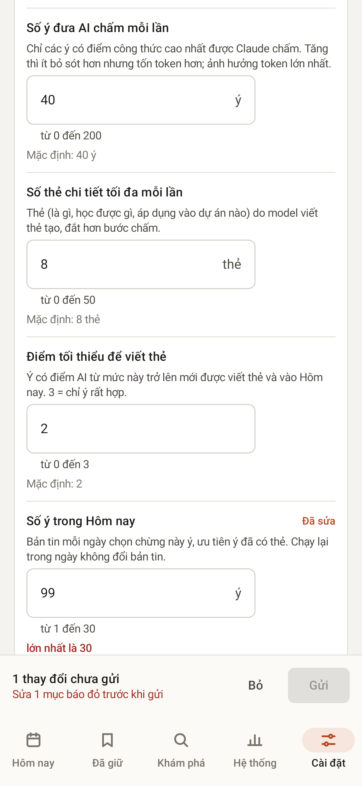

## phone-settings-light

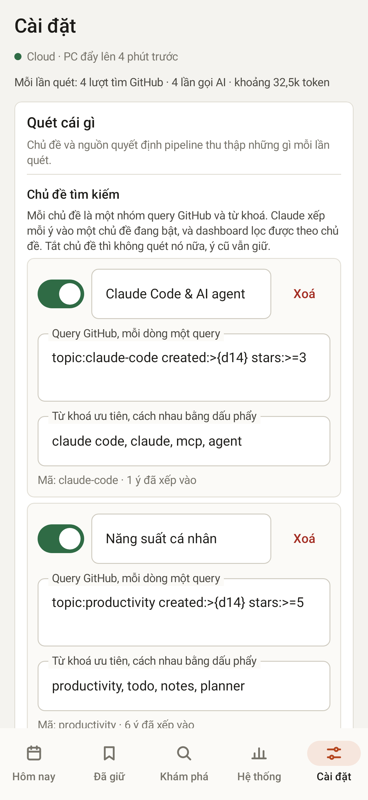

## phone-settings-savebar

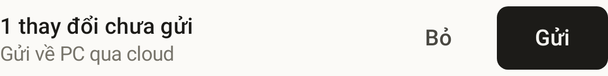

## phone-settings-status

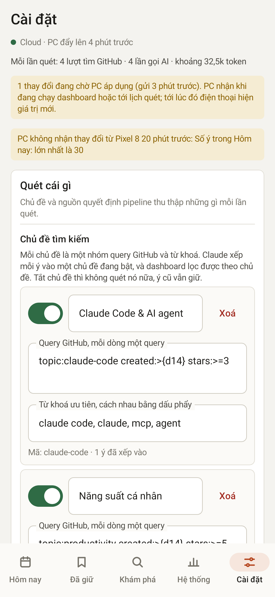

## phone-signin-refused

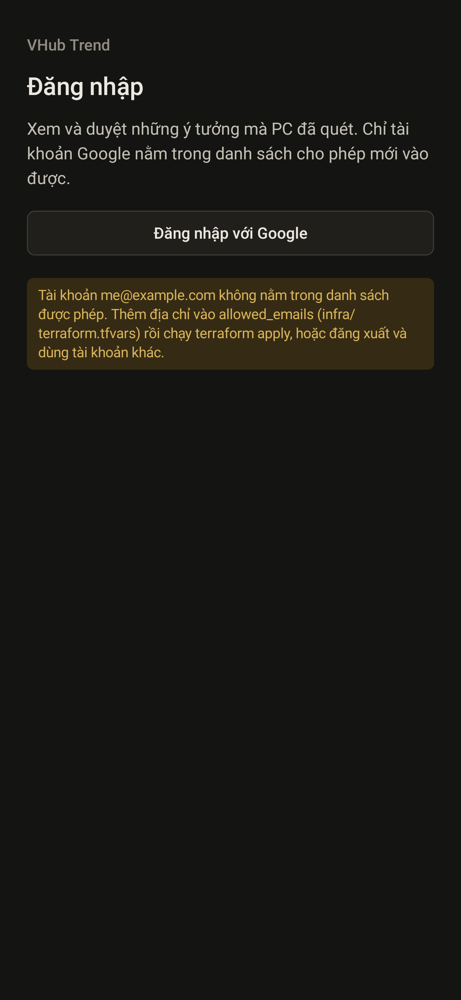

## phone-signin-unconfigured

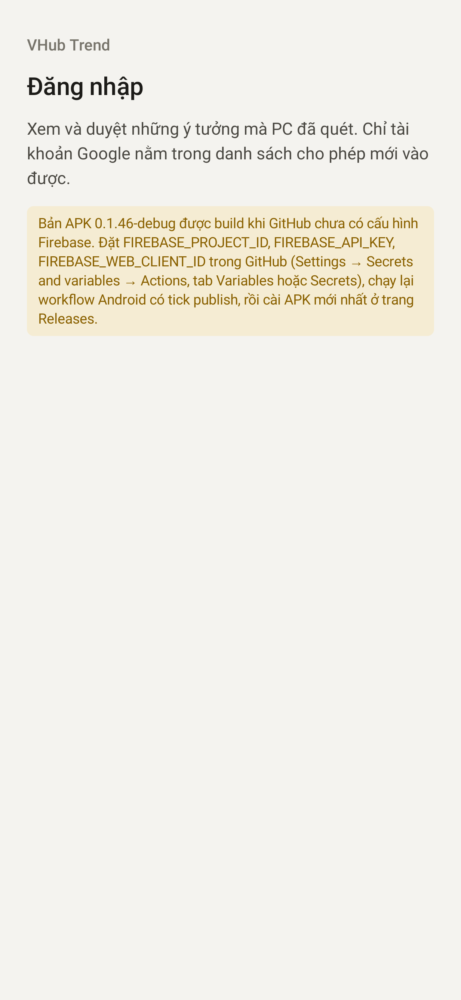

## phone-signin

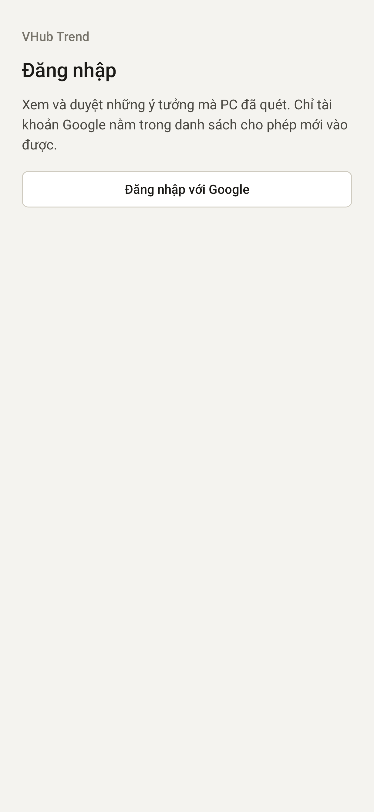

## phone-signout-confirm

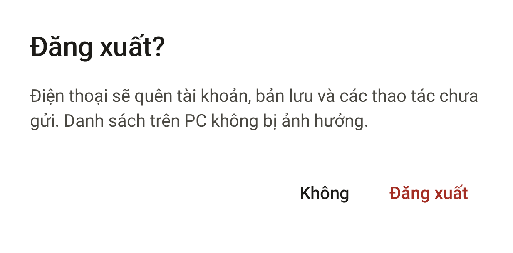

## phone-system-cloud-scan

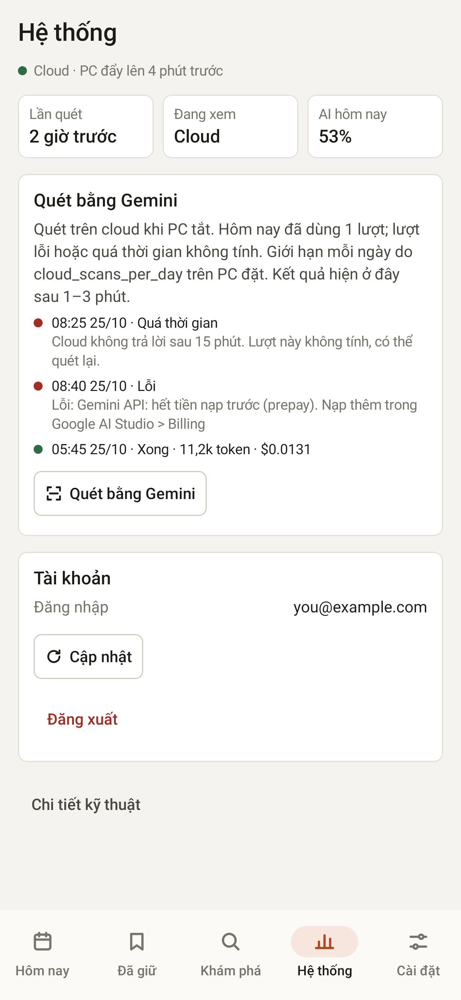

## phone-system-dark

## phone-system-technical

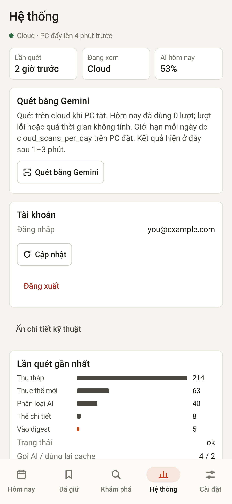

## phone-today-dark

## phone-today-light

## phone360-detail-light

## phone360-settings-light

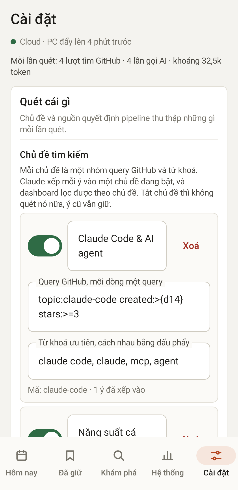

## tablet-explore-dark

## tablet-settings-dark

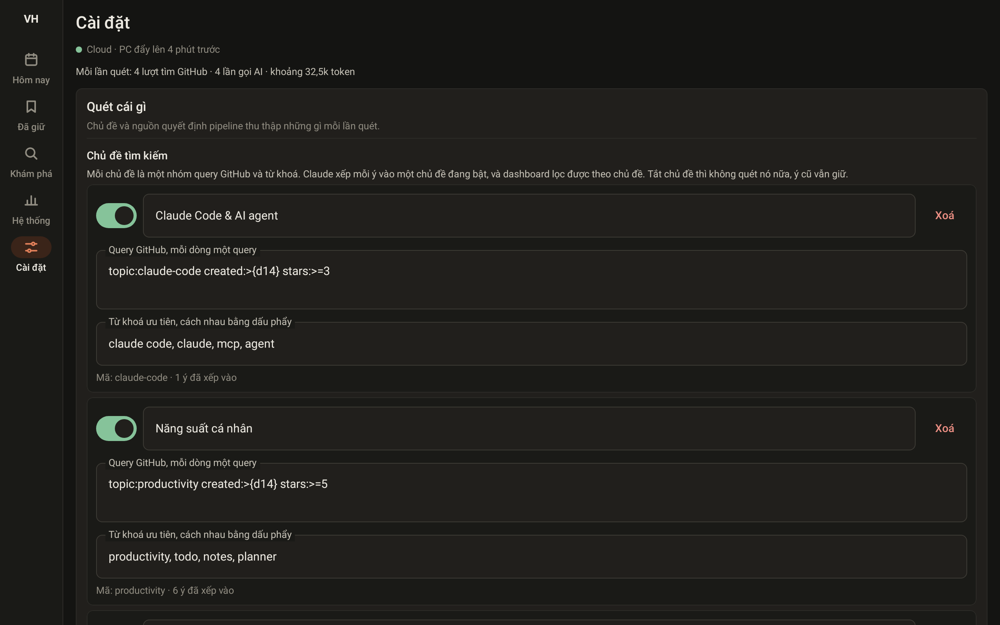

## tablet-today-light

