# Android screenshots

Branch `main`, commit 73c89ad, run 15.

## phone-detail-dark

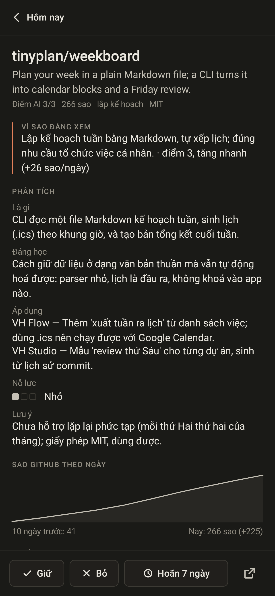

## phone-detail-light

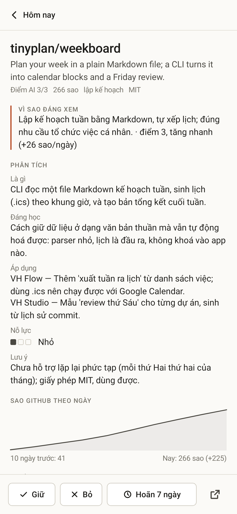

## phone-kept-cloud

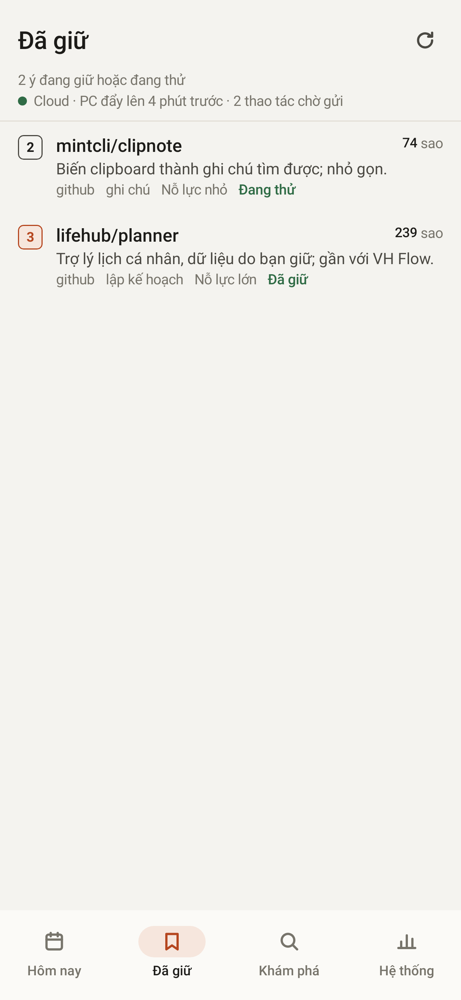

## phone-offline-cache

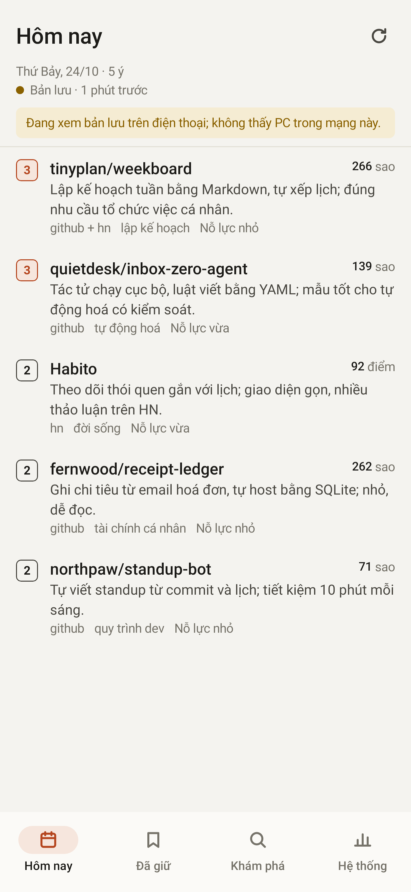

## phone-pair

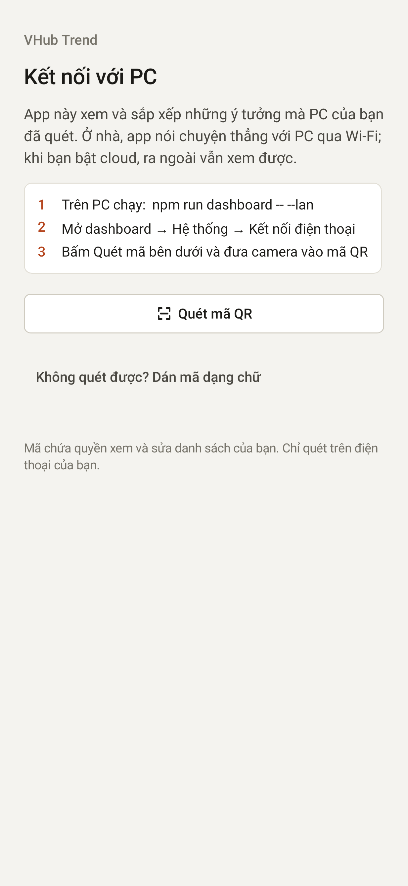

## phone-system-dark

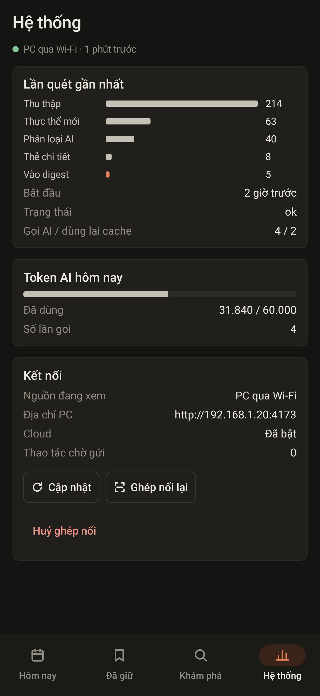

## phone-today-dark

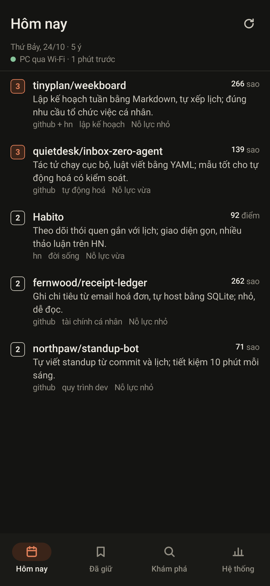

## phone-today-light

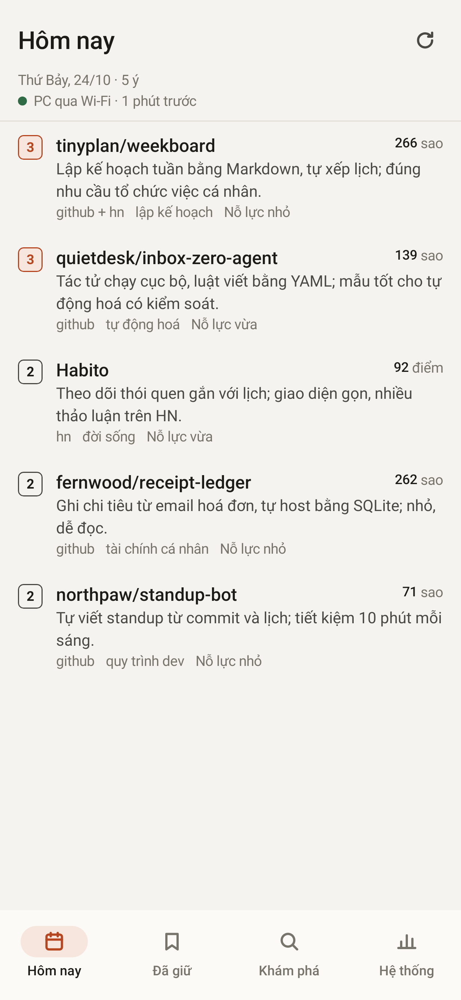

## phone-unpair-confirm

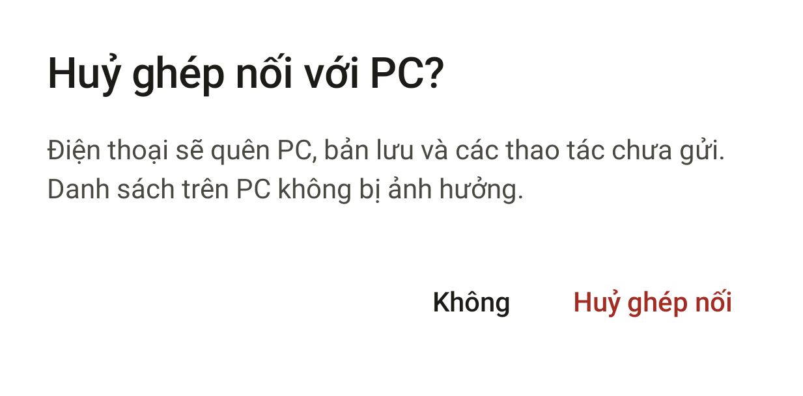

## phone360-detail-light

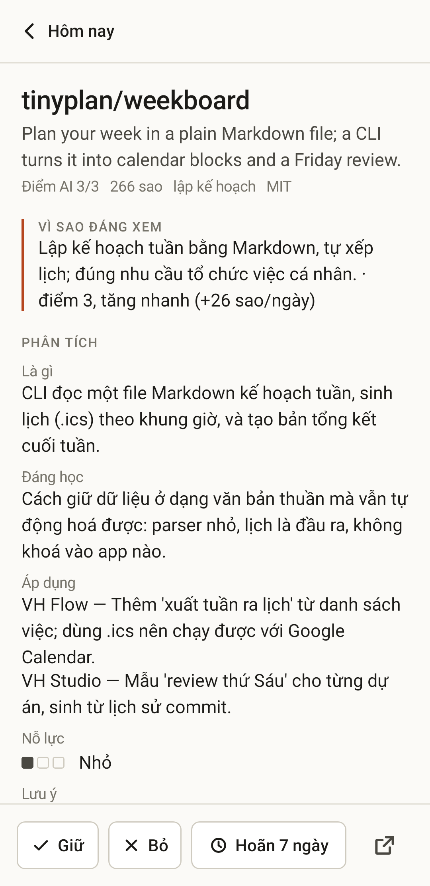

## tablet-explore-dark

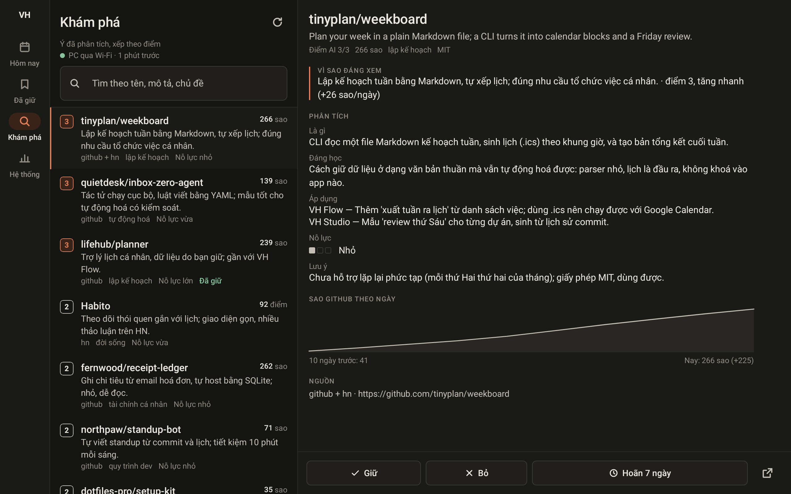

## tablet-today-light

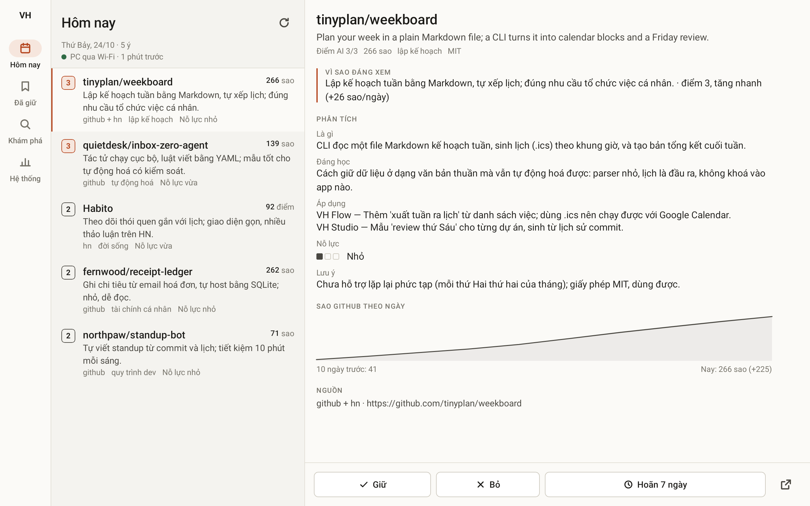

